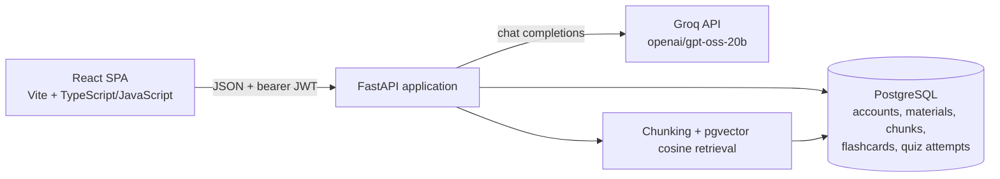
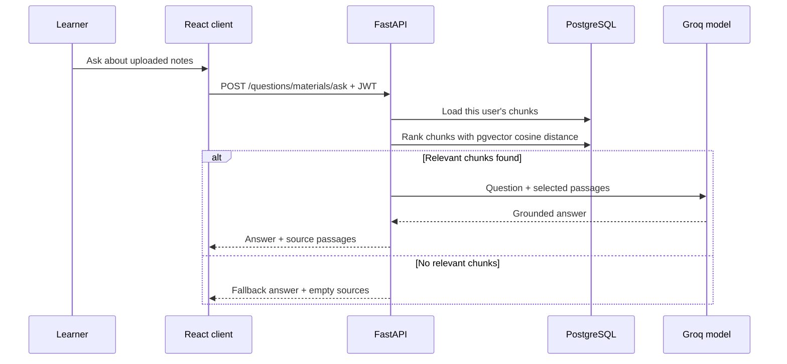

# Quizlet — AI-assisted study workspace

Turn your own notes into a focused study session. Add text or upload a PDF, TXT, or Markdown file; ask questions grounded in those materials; generate flashcards or a quiz; then review recall and quiz history.

> **Project type:** full-stack learning application  
> **Stack:** React, Vite, TypeScript/JavaScript, FastAPI, SQLAlchemy, PostgreSQL, Groq API, Docker, GitHub Actions

## Why I built it

Study material is often spread across notes and documents, while reviewing it takes manual effort. This project explores a complete workflow that takes a learner's source material and turns it into interactive practice. The central engineering challenge is keeping generated study content tied to retrieved passages, while also building the surrounding product: accounts, persistence, API boundaries, deployment, and failure handling.

## What it does

- **Bring your material:** paste notes or upload PDF, TXT, and Markdown. The backend extracts text, splits it into overlapping chunks, and stores them in PostgreSQL.
- **Ask questions with sources:** pgvector cosine search selects relevant embedded chunks. The Groq-hosted `openai/gpt-oss-20b` model answers from those passages, and the API returns the passages used. No matching passage produces a no-context fallback instead of a model answer.
- **Generate study practice:** create saved flashcard sets (1–40 cards) from selected materials and request quiz questions through the material chat. Flashcard review and quiz attempts are persisted.
- **Track learning:** review past quiz scores and recall totals for flashcards.
- **Manage access:** JWT bearer authentication, role-protected admin question-bank/quiz creation, and user-scoped study data.
- **Handle service failures:** configurable request timeout, concurrency limit, circuit breaker, request limits, client-disconnect cancellation, and generic responses for unhandled server errors.

## Product walkthrough

1. Create an account and sign in.
2. Add a set of notes or upload a supported document in **Study materials**.
3. Ask a question or request a quiz in the material chat; inspect the retrieved source passages.
4. Generate flashcards from one or more materials, study them, and record whether you remembered each one.
5. Take a catalog quiz and review saved attempts and study progress.

## Architecture



The frontend uses React Router, API service modules, and protected routes. The backend groups HTTP endpoints into routers, validates request/response shapes with Pydantic, and separates database models from service logic. SQLAlchemy maps application records to PostgreSQL. The LLM call is made by the backend, so the provider key is not shipped in the browser bundle.

### Material question flow



## Technology and design choices

| Area | Implementation | Reason / trade-off |
| --- | --- | --- |
| UI | React SPA, Vite, React Router, Tailwind CSS | Fast iteration and a clear separation between page components and API clients. The repository uses both `.jsx` and `.tsx`; it is not a fully TypeScript-migrated frontend. |
| API | FastAPI, Pydantic, SQLAlchemy | Typed request validation, generated OpenAPI docs, and familiar relational data modeling. |
| Persistence | PostgreSQL + pgvector | Relational ownership/history records plus database-native vector storage and cosine search. |
| Retrieval | Text normalization, overlapping chunks, local `all-MiniLM-L6-v2` embeddings (384-dim ONNX, no API key), pgvector | Database-native semantic retrieval that handles paraphrased questions. A remote OpenAI-compatible provider can be configured instead. |
| Generation | Groq's OpenAI-compatible chat completions endpoint | Keeps model calls behind the API and supports structured output prompts for cards and quiz questions. Model output still needs user review. |
| Delivery | Dockerfiles, Compose, Render blueprint, GitHub Actions | Reproducible local stack and automated build/test/image-publish workflow. |

## Local setup

Requirements: Docker Desktop or Docker Engine with Compose, and a Groq API key.

```powershell
Copy-Item .env.example .env
# Edit .env and set GROQ_API_KEY (and JWT_SECRET_KEY for anything beyond a demo)
docker compose up -d --build
```

Compose builds the backend and client from source and starts PostgreSQL with pgvector, the FastAPI API, and the web client. Open `http://localhost`. The API is at `http://localhost:8000`, with interactive OpenAPI docs at `http://localhost:8000/docs`. Re-run `docker compose up -d --build` after code changes. Compose creates a persistent PostgreSQL volume: `docker compose down` stops services, and `docker compose down -v` also deletes that database volume.

Backend tables are created from SQLAlchemy metadata at startup, and pgvector is enabled automatically. This project does not yet include a migration workflow.

## Configuration

See [backend environment example](quizlet-backend/.env.example) and [Compose environment example](.env.example).

| Variable | Purpose |
| --- | --- |
| `DATABASE_URL` | PostgreSQL connection string (`postgresql+psycopg://...`). |
| `JWT_SECRET_KEY` | JWT signing secret; at least 32 characters. Use a unique random secret outside local demos. |
| `GROQ_API_KEY` | Provider credential used only by the backend. |
| `LLM_BASE_URL` | OpenAI-compatible provider base URL; defaults to Groq. |
| `LLM_CHAT_MODEL` | Chat model identifier; defaults to `openai/gpt-oss-20b`. |
| `CORS_ORIGINS` | Comma-separated browser origins allowed by the API. |
| `LLM_REQUEST_TIMEOUT_SECONDS` | Provider request timeout. |
| `LLM_MAX_CONCURRENCY` | Maximum simultaneous guarded LLM calls in this process. |
| `MATERIAL_CHUNK_CHARS` / `MATERIAL_CHUNK_OVERLAP` | Chunk length and overlap used during material indexing. |
| `MATERIAL_MAX_UPLOAD_BYTES` | Maximum accepted upload size. |
| `EMBEDDING_PROVIDER` / `EMBEDDING_LOCAL_MODEL` | Default `local` / `sentence-transformers/all-MiniLM-L6-v2`: an in-process ONNX model baked into the backend image, so no key, cost, or runtime download. `hash` is a lexical, non-semantic fallback used by the test suite only. |

## API map

All protected routes use an `Authorization: Bearer <token>` header. OpenAPI's interactive UI is the most current full reference.

| Route group | Representative endpoints | Purpose |
| --- | --- | --- |
| Auth | `POST /auth/signup`, `POST /auth/login`, `GET /auth/me` | Account creation, token issuance, current user. |
| Materials | `POST /questions/materials/text`, `POST /questions/materials/upload`, `POST /questions/materials/ask` | Add/retrieve study content and ask grounded questions. |
| Flashcards | `POST /quiz/flashcards/generate`, `GET /quiz/flashcards`, `POST /quiz/flashcards/{id}/review` | Generate sets and record recall. |
| Quizzes | `GET /quiz`, `POST /quiz/{id}/attempts`, `GET /quiz/attempts` | Browse, score, and review attempts. |
| Admin | `POST /questions`, `POST /quiz/create` | Maintain the question bank and quiz catalog. |
| Health | `GET /health`, `GET /llm/status` | Check database/provider availability. |

## Testing and automation

```powershell
cd quizlet-backend
pip install -r requirements-dev.txt
python -m compileall -q app tests
python -m pytest -q tests

cd ..\quizlet-client
npm ci
npm run build
npm run lint
```

GitHub Actions runs backend compilation and tests, backend Docker build, and client production build on pushes and pull requests. On pushes to `main`, it publishes backend and client Docker images to Docker Hub when repository secrets `DOCKERHUB_USERNAME` and `DOCKERHUB_TOKEN` are configured. The optional repository variable `VITE_API_BASE` sets the client API base used in that image build.

## Honest scope and current limitations

These are useful interview talking points because they show the boundaries of the current implementation:

- Retrieval uses pgvector cosine distance over local `all-MiniLM-L6-v2` embeddings by default. The response field named `similarity` is a normalized distance score, not a calibrated probability. Changing the embedding provider or model requires re-embedding stored chunks: `docker compose exec backend python -m app.reembed`.
- PDF support extracts selectable text only; scanned documents need OCR. Very large corpora would need more efficient indexed retrieval and likely a vector or hybrid search design.
- The model can return inaccurate or malformed content. Structured output is parsed and validated, but generated questions/cards still need human review; source passages are evidence, not a factuality guarantee.
- Material records are owned by the user and survive subsequent logins and logout. The legacy session ID remains in tokens for compatibility but is no longer a retention boundary.
- Structured generation retries malformed output. Retrieval quality is checked with `quizlet-backend/app/retrieval_check.py` against the protocol in `quizlet-backend/tests/RETRIEVAL_PROTOCOL.md`.
- Signup always creates standard users. Admin access is granted only by setting `users.role` to `ADMIN` directly in the database, e.g. `UPDATE users SET role = 'ADMIN' WHERE username = 'your-user';`.
- Rate-limit counters and the LLM concurrency limiter are in-process. Rate limiting is not shared across workers/instances; a horizontally scaled deployment needs a shared store such as Redis.
- SQLAlchemy creates tables at app startup. A production evolution should add Alembic migrations, deployment-specific secrets, and operational monitoring.
- The Compose file includes demo defaults and publishes the API port. Do not expose the demo configuration publicly; set strong secrets, restrict network access, and review deployment settings first.

## Repository layout

```text
quizlet-backend/   FastAPI application, SQLAlchemy models, services, tests
quizlet-client/    React frontend, API clients, Vite and nginx configuration
docker-compose.yml Local full-stack Compose configuration
render.yaml        Backend Render deployment blueprint
.github/workflows/ CI, Docker build, and image publishing
```

## License

No license has been selected. Until one is added, assume all rights are reserved.
